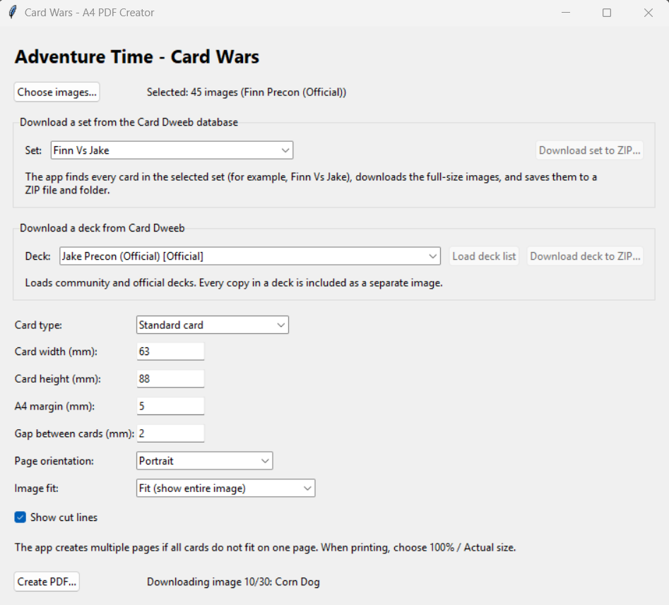

# Adventure Time: Card Wars PDF Creator

A small tool for creating printable PDF sheets of cards for the **Adventure
Time Card Wars** game. Choose local card images or download a card set or deck
from Card Dweeb, arrange the images at a chosen size on A4 pages, and print the
result.

This is a fan-made printing utility. It is not affiliated with or endorsed by
Adventure Time, Cryptozoic Entertainment, Frederator Studios, Cartoon Network,
or Card Dweeb.

## Features

- Create multi-page A4 PDFs from card images on your computer.
- Download all cards in a set from the Card Dweeb database.
- Load official and community decks from Card Dweeb and download their cards.
  Multiple copies of a card in a deck are saved as separate images.
- Choose standard card, hero card, field card, or custom dimensions.
- Configure page orientation, margins, spacing, image fitting, and cut lines.
- Reduce PDF size with selectable 20%, 40%, or 60% image-quality reduction
  (40% by default), with an original-quality option.
- Optionally infer standard, hero, or field card dimensions and landscape
  orientation from each image's aspect ratio.
- Save downloaded images to both a ZIP archive and a folder.
- Use a browser-based print studio served locally on your computer.

## Screenshot



## Getting started

### Use the browser-based print studio

1. Install Python 3.12 or later and the dependencies listed below.
2. Start the local web server:

   ```powershell
   python card_wars_web.py
   ```

3. The app opens in your browser. Choose image files, adjust the print
   settings, select a compression level, and choose **Create printable PDF**.
4. To use Card Dweeb, choose a card set and select **Download set**, or load
   the deck list, choose a deck, and select **Download deck**. The images are
   added to the current print selection and the downloaded cards are also
   saved to a ZIP file.
5. Select **Download printable tokens** to download the included two-sided
   token sheet PDF.

The web page and PDF generation run on your computer at `127.0.0.1`; card
images are not uploaded to an external service. Keep the terminal window open
while using the page and press **Ctrl+C** there to stop the server. Uploads are
limited to 256 MB per PDF request when selecting local files. Card Dweeb
downloads are processed directly from the server's temporary files and are
not re-uploaded by the browser, so larger downloaded decks avoid that limit.

The browser interface creates PDFs from local image files and server-stored
Card Dweeb downloads. Card set/deck
downloads are retrieved from Card Dweeb and its public image sources. Internet
access is required for the set/deck tools; local image printing does not
require an internet connection.

### Run the source file

1. Install Python 3.12 or later.
2. Install the dependencies:

   ```powershell
   python -m pip install reportlab pillow
   ```

3. Run the app:

   ```powershell
   python card_wars_pdf.py
   ```

## Using the app

### Create a PDF from local images

1. Select **Choose images...** and choose the card image files to print.
2. Select a card type preset, or enter a custom width and height in millimeters.
3. Set the A4 margin and the gap between cards.
4. Choose portrait or landscape orientation, then select how images should fit:
   - **Fit (show entire image)** keeps the whole image visible without
     distortion.
   - **Fill (crop edges)** fills the card area and crops any excess at the
     edges.
5. Enable or disable **Show cut lines** as desired.
6. Choose **100% quality** to embed the original image without lossy
   conversion, or reduce image quality by 20%, 40% (default), or 60% for
   progressively smaller files. Higher compression may cause visible image
   quality loss.
7. Optionally enable automatic card sizing. The app compares each image's
   aspect ratio and card filename, assigns Landscape cards the Field Card
   dimensions, detects horizontal orientation, and lays out each detected
   size on its own pages. Unusual or cropped images may not be classified
   correctly, so manual sizing remains available.
8. Select **Create PDF...** and choose where to save the PDF.

Reduced-quality compression re-encodes card images as JPEG at a quality
corresponding to the selected reduction; it does not change the original image
files. This can substantially reduce PDFs made from large PNG images.

The app creates as many pages as needed. When printing, choose **100%** or
**Actual size** rather than scaling the PDF to fit the paper.

### Download a card set

1. In **Download a set from the Card Dweeb database**, select or enter a set.
2. Select **Download set to ZIP...** and choose where to save the archive.
3. The app saves the downloaded images to a folder next to the ZIP and loads
   them into the PDF creator.

### Download a deck

1. In **Download a deck from Card Dweeb**, select **Load deck list**.
2. Choose a deck from the list. Official and community decks are labeled.
3. Select **Download deck to ZIP...** and choose where to save the archive.
4. The app saves the deck images to a folder next to the ZIP and loads them
   into the PDF creator. Each card copy in the deck is included separately.

Internet access is required to load deck lists and download sets, decks, and
card images. The available decks and cards depend on Card Dweeb.

## Card dimensions and print accuracy

The included dimensions are starting points and are not guaranteed to match
official card dimensions. Measure your own cards and adjust the width and
height if accurate sizing is important. Printer settings and printer hardware
can also affect the final size.

## Building the Windows executable

Install the app dependencies and PyInstaller:

```powershell
python -m pip install reportlab pillow pyinstaller
```

Build using the included spec file:

```powershell
python -m PyInstaller --noconfirm CardWarsPDF.spec
```

The executable is written to `dist/CardWarsPDF.exe`.

## Credits and card content

Card images, names, and game content belong to their respective copyright
holders. Card data and images are retrieved from [Card Dweeb](https://www.carddweeb.com/)
and the [CardWarsData repository](https://github.com/itderrickh/CardWarsData).
Please review Card Dweeb's [developer resources](https://www.carddweeb.com/Resources/Developers)
and the relevant source repositories before using or redistributing their
content.

## License

The source code for this project is licensed under the MIT License. See
[LICENSE](LICENSE) for the full text.
